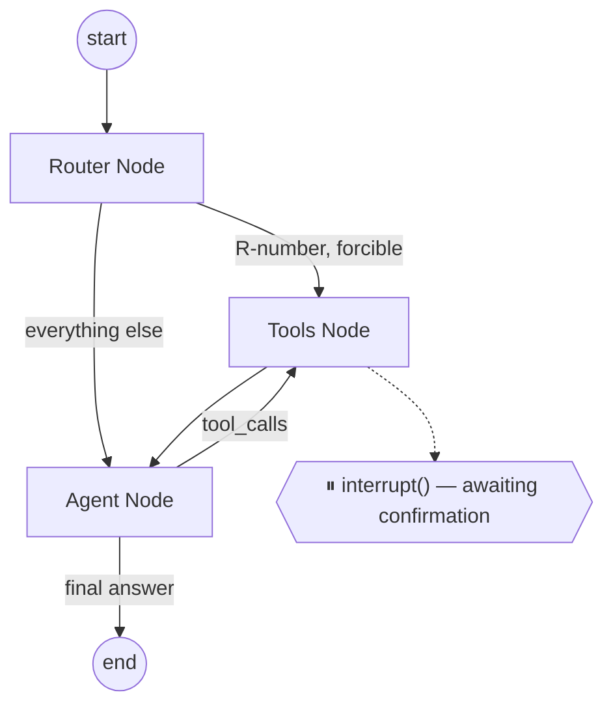

# Car Rental AI Agent

A production-shaped AI customer-service agent for a car rental company: vehicle
search, reservation management, and policy Q&A via RAG — built with
**LangGraph** (ReAct + human-in-the-loop confirmation), **FastAPI**, and
**Streamlit**.

Built as a second-interview take-home exercise, and deliberately engineered
beyond the minimum ask to demonstrate production thinking: layered
architecture, structured logging, a two-tier config system, dual-mode auth
(simulated JWT + real Microsoft Entra ID), an eval harness, ADRs, and a
from-scratch learning log (`docs/LEARNING_NOTES.md`) documenting every design
decision as it was made.

## Project overview

| Requirement (from the brief) | Where it's implemented |
|---|---|
| Vehicle search (location, dates, passengers, luggage, category, budget) | `app/agent/tools/search_vehicles.py` → `VehicleService` |
| Reservation status lookup | `app/agent/tools/get_reservation.py` → `ReservationService` |
| Policy Q&A via RAG | `app/agent/tools/policy_rag.py` → Chroma + fastembed |
| Human confirmation before cancel/modify | `interrupt()` + `SqliteSaver` — see `docs/adr/0001-*.md` |
| Router Node | `app/agent/router.py` — hybrid rule + ReAct, see `docs/adr/0005-*.md` |
| JWT auth | `app/dependencies/auth.py` (dual-mode: simulated + real Entra ID) |

## Architecture

See [`docs/architecture.md`](docs/architecture.md) for the full diagram set
(layered dependencies, the LangGraph flow, the HITL confirmation sequence,
and the dual auth-mode flow). Summary:

```
domain (enums/models) -> repositories (data access) -> service (business logic)
    -> agent (tools, router, graph) -> api (FastAPI routers) -> ui (Streamlit)
```



## Tech stack

| Layer | Choice | Why |
|---|---|---|
| Language | Python 3.13 | — |
| Agent framework | LangGraph (hand-built graph, ReAct pattern) | explicit control over the Router Node + `interrupt()` HITL |
| RAG | LangChain + Chroma + fastembed (local) | zero-infra vector store; runs with no API key — see `docs/adr/0002-*.md` |
| LLM | Google Gemini / OpenAI / Anthropic (provider-agnostic factory) | `app/service/llm/llm_factory.py`, switch via `LLM_PROVIDER` |
| API | FastAPI + SSE (`sse-starlette`) | `app_car_rental.py` |
| UI | Streamlit | `app/ui/streamlit_app.py` — thin HTTP client, no business logic |
| Auth | JWT simulation (default) + real Microsoft Entra ID (practice mode) | `app/dependencies/auth.py`, dual-mode via `AUTH_MODE` |
| Config | Two-tier: `config.yaml` (tunables) + `.env` (secrets) | `app/utils/config.py` — see `docs/adr/0004-*.md` |
| Package manager | `uv` | single lockfile, fast, modern |
| Tests | pytest (58 tests: unit + integration + eval harness) | `make test` runs the credential-free subset |

## How to run locally

```powershell
# 1. Install dependencies
uv sync --all-extras

# 2. Configure environment
cp .env.example .env
# edit .env: set LLM_PROVIDER and the matching API key (e.g. GOOGLE_API_KEY)

# 3. Build the policy RAG index (local embeddings, no API key needed)
uv run python scripts/build_index.py --rebuild

# 4. Run the API (terminal 1)
make run        # uv run uvicorn app_car_rental:app --reload --port 8081

# 5. Run the UI (terminal 2)
make ui         # uv run streamlit run app/ui/streamlit_app.py
```

Open http://localhost:8501, pick a customer from the sidebar, and chat.

### Running with Docker

```bash
docker compose up --build
```

Starts the API (`:8081`) and UI (`:8501`). Set real provider keys via a `.env`
file in the same directory as `docker-compose.yml` (Compose reads it
automatically) or export them in your shell before running.

> **Note:** Docker wasn't available in the environment this project was built
> in, so the `Dockerfile`/`docker-compose.yml` are carefully written and
> path-traced against the actual application code (see
> `docs/LEARNING_NOTES.md`) but not build-tested end-to-end. Please report an
> issue if `docker compose up --build` doesn't work as expected.

### Running tests

```powershell
make test              # uv run pytest -m "not llm" — no API key required, CI-safe
uv run pytest -m llm   # also exercises real LLM calls + the eval harness's tool-choice tier
```

58 tests total. The default `make test` run needs zero credentials and zero
network access beyond the one-time local embedding model download.

## Sample conversations

The brief's five sample conversations, and how to reproduce them:

1. *"I want to rent an SUV in Penang from 10 Oct to 15 Oct for 4 people"* → `search_vehicles`
2. *"What is the status of my reservation R001?"* → `get_reservation` (router-forced)
3. *"What happens if I cancel my reservation?"* → `policy_rag`, cites `cancellation.md`
4. *"I want to cancel my booking R002"* → `cancel_reservation`, pauses for confirmation
5. *"Do you provide roadside assistance?"* → `policy_rag`, cites `roadside_assistance.md`

> **Screenshots:** not included in this submission — generating them requires
> a real LLM API key, which wasn't configured in the build environment. To
> capture them yourself: `make run` + `make ui` in two terminals, log in as
> any customer in the sidebar, run the five conversations above, and
> screenshot the chat panel (showing the answer) and the sidebar's "Tool call
> trace" panel (showing the routing/tool_call/tool_result events) for each.
> `tests/evals/dataset.yaml` has the exact wording used for grading, including
> five additional adversarial cases (IDOR, double-cancel, prompt injection,
> out-of-scope, budget-constrained search).

## Security

- **IDOR guard**: `customer_id` is always derived from the verified
  JWT/Entra token server-side (`InjectedState`, never an LLM-controllable
  tool argument) and re-checked by `ReservationService` on every read/write —
  structural enforcement, not just a prompt instruction. Covered by
  `tests/evals/dataset.yaml`'s `idor_other_customers_reservation` case.
- **Idempotency**: cancelling/modifying an already-cancelled reservation
  short-circuits before ever pausing for confirmation (see
  `docs/LEARNING_NOTES.md` Lesson 47).
- **Prompt-injection resistance**: the system prompt explicitly refuses
  "ignore previous instructions"-style messages, backed by the structural
  IDOR guard above that holds even if the prompt-level instruction is
  bypassed.
- **Secrets**: `.env` only, gitignored; `.env.example` documents every
  variable with no real values. See `docs/adr/0006-secrets-hygiene.md`.
- **Rate limiting**: in-memory sliding-window limiter (`app/api/rate_limit.py`),
  configurable via `config.yaml`'s `RATE_LIMIT` block.
- **Generic error responses**: every exception maps to a safe, generic
  message for the client; real detail is logged (with PII/secret redaction)
  but never returned over the wire.

## Microsoft Entra ID (practice mode)

`AUTH_MODE=simulated` (default) satisfies the brief's "JWT token simulation"
requirement out of the box. `AUTH_MODE=entra` is an optional practice mode
using a real Microsoft Entra ID device-code login (public client, no secret
ever stored). Run `scripts/setup_entra.sh` for a guided App Registration
walkthrough, then set `AUTH_MODE=entra`, `ENTRA_TENANT_ID`, and
`ENTRA_CLIENT_ID` in `.env`.

## What I learned

Documented in full, decision-by-decision, in
[`docs/LEARNING_NOTES.md`](docs/LEARNING_NOTES.md) — 48 lessons spanning
every phase of the build. Highlights:

- **LangChain's v1.x restructuring moved things non-obviously** (text
  splitters became a separate package; provider constructor kwargs follow
  pydantic *aliases*, not field names, and the alias direction differs
  between providers). Verifying with `inspect.signature()`/`model_fields`
  before writing code against an API saved a second round of guess-and-fix
  more than once.
- **A relevance threshold is a property of the embedding model, not a
  universal constant.** A cosine-distance cutoff copied from a reference
  implementation (tuned for a different embedding model) silently broke
  retrieval; recalibrating against real measured distances fixed it.
- **`interrupt()` + a checkpointer is what makes durable human confirmation
  possible** — proven by actually restarting the server mid-pause and
  resuming successfully, and by a real Windows file-locking bug that
  surfaced only when two tests shared a cached Chroma connection.
- **Writing the eval dataset is itself a design review.** Working through
  the `double_cancel_already_cancelled` adversarial case surfaced a real gap:
  the tool asked for confirmation *before* checking whether the action was
  even possible. The fix came from writing down what "correct" looks like in
  advance, not from a unit test written after the fact.
- **No amount of backend test coverage substitutes for actually running the
  UI.** The backend's automated tests were thorough and green the whole
  time; a real bug (an uncaught `httpx.HTTPStatusError` crashing the entire
  Streamlit script on any backend failure) only showed up by clicking
  through the running app in a real browser.

## What I'd do next in production

- Real token-level SSE streaming (`astream_events`) instead of replaying a
  pre-computed trace — see `app/service/llm/streaming.py`'s docstring.
- A Redis cache in front of the checkpointer if read latency at scale ever
  justified it — not built here because there was no load number to justify
  the extra infrastructure (see `docs/LEARNING_NOTES.md` Phase 6 Q&A).
- A TTL sweep for threads paused on `interrupt()` that are never resumed.
- LLM-as-judge grading for the eval harness's answer *quality*, layered on
  top of the existing exact-tool-match grading (which checks *routing*
  correctness, a different and complementary signal).
- Swap the in-memory rate limiter for a Redis-backed one for multi-instance
  deployments.
