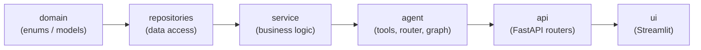
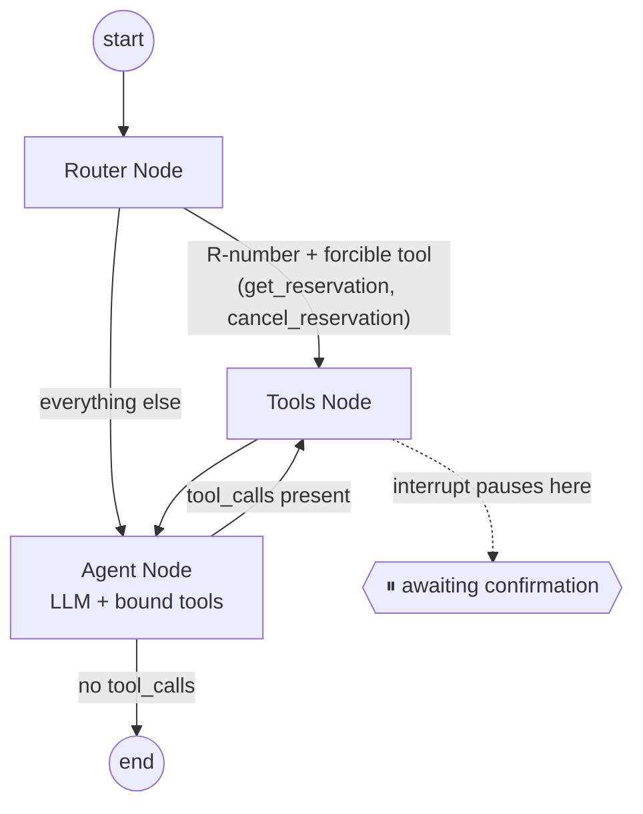
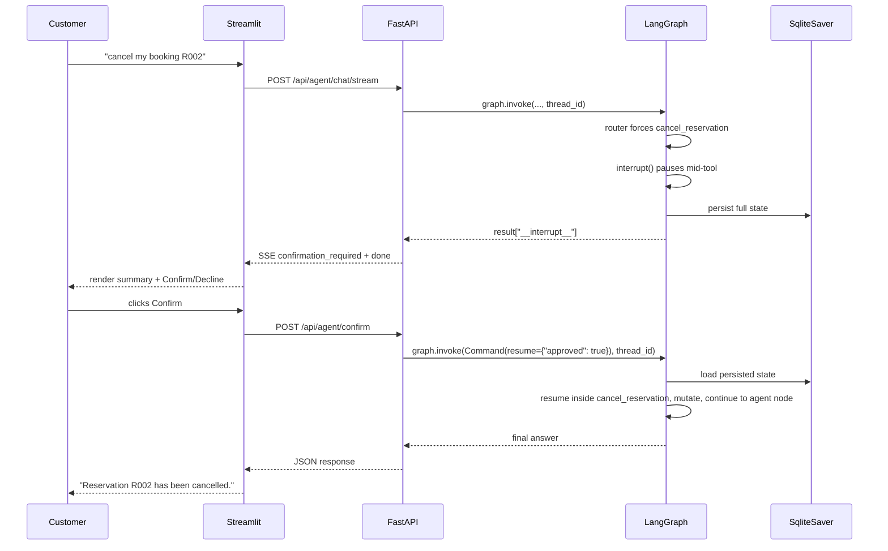
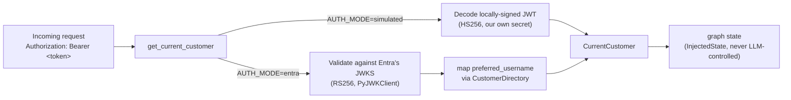

# Architecture

## Layered dependency direction

Dependencies only point inward-to-outward: `agent` never imports from `api`
or `ui`; `service` never imports from `agent`. See `AGENTS.md`.

## The LangGraph agent

- **Router Node** (`app/agent/router.py`): regex fast-path forces a tool call
  directly for unambiguous ID-based cases, skipping an LLM round-trip
  entirely; everything else defers to the agent node's own tool-choice.
- **Agent Node**: binds all five tools to the configured LLM
  (`app/service/llm/llm_factory.py`) and lets it decide, chaining multiple
  tools for compound questions.
- **Tools Node**: a prebuilt `ToolNode` executing whichever tool the model
  (or the router) selected. `cancel_reservation`/`modify_reservation` call
  `interrupt()` here, pausing graph execution until a separate
  `Command(resume=...)` call continues it.

## Human-in-the-loop confirmation sequence

## Auth dual-mode

See `docs/adr/` for the reasoning behind each of these decisions.
